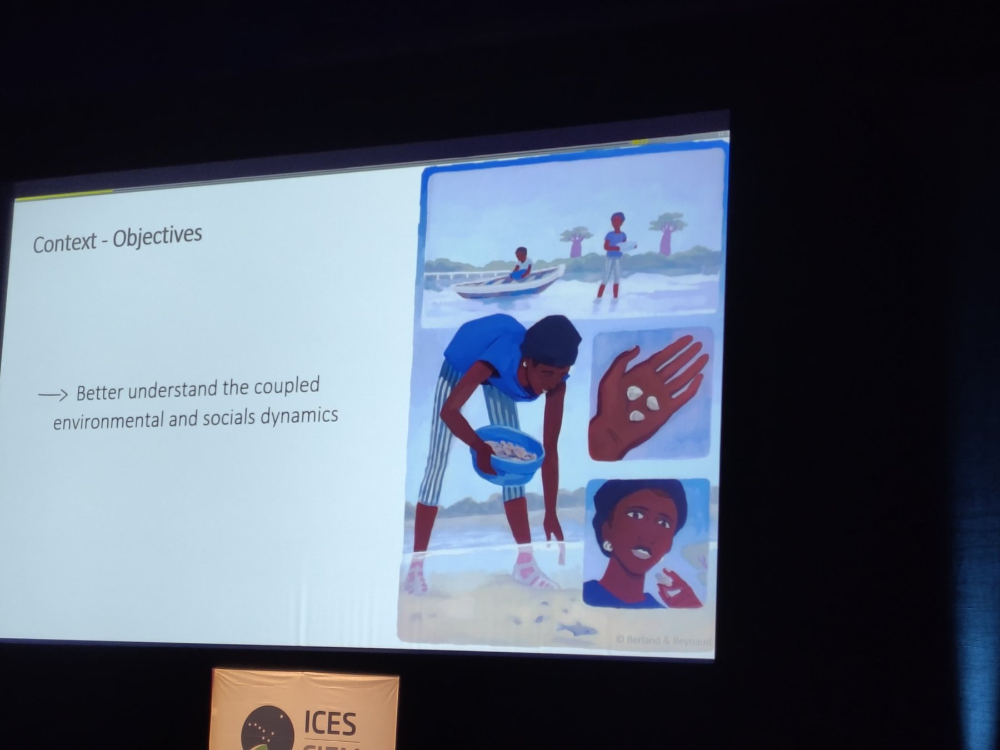

The Annual Science Conference (ASC) of the International Council for the Exploration of the Sea (ICES) took place on 15–18 September in Brest, France. EconSES postdoctoral researcher [Dr. Maartje Oostdijk](/author/maartje-oostdijk/) attended on behalf of the lab, presenting work on climate-ready fisheries harvest strategies and on how trade agreements affect seafood trade and production.

ICES is an intergovernmental marine science organization that provides scientific evidence and advice to support the sustainable management of marine ecosystems and fisheries in the North Atlantic and adjacent seas. Stock assessment is a central part of its work, and the conference follows an often intense week of meetings for scientists working on stock assessments. The ASC, however, reaches beyond stock assessment and is an important gathering for researchers studying marine social-ecological systems.

### A call for social and economic research

The need for social and economic data and analysis was stressed prominently in the plenary sessions. The theme sessions, however, largely focused on ecological questions, with a theme session on participatory modeling as the main exception. Maartje also noticed what was missing from the program.

I was surprised by how few sessions focused directly on stock assessment, given its central role within ICES.

### Eight minutes per talk

The ASC uses an eight-minute presentation format, which offers a broad overview of ongoing research, though the pace can be overwhelming. "With speakers fitting so much information into such short slots, there is little time to absorb one presentation before the next begins," Maartje says. "Despite the short time slots, it was obvious that both the research and the presentations were of very high quality."

Fortunately, generous lunch breaks provided time to catch up with colleagues and, in Maartje's words, to "give the brain a little rest from the intense theme sessions."

### Highlights: climate models and bycatch

One of my highlights of the conference was the theme session ‘Climate models to advice’.

The session hosted impressive ecosystem modeling research on incorporating climate change and uncertainty in stock assessments into (ecosystem-based) modeling and fisheries advice.

Maartje also found the sessions on bycatch reduction interesting. They gave insights into technical innovations and management approaches, but also into the clash between ideals of ecosystem protection and utilization. "For instance, it proves challenging to decide together with fishers which areas are best closed to reduce bycatch," she explains, "as closing these areas can also carry high opportunity costs for fishery participants."

### Next stop: Copenhagen

Next year's ASC will take place in Copenhagen, and Maartje is already looking ahead: "I'm looking forward to next year's meeting in Copenhagen!"
