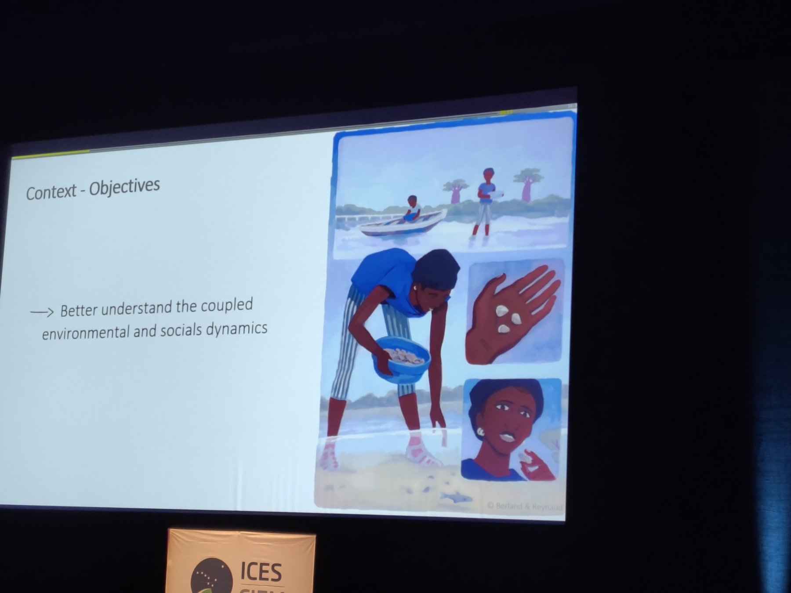

The Annual Science Conference (ASC) of the International Council for the Exploration of the Sea (ICES) took place on 15–18 September in Brest, France. I joined as a member of the EconSES lab to present work on climate-ready fisheries harvest strategies and on the impacts of trade agreements on seafood trade and production.

ICES is an intergovernmental marine science organisation that provides scientific evidence and advice to support the sustainable management of marine ecosystems and fisheries in the North Atlantic and adjacent seas. Stock assessment is a central part of the work of ICES, and the conference follows an often intense week of meetings for scientists working on stock assessments. The ASC, however, reaches beyond stock assessment and is an important gathering for researchers studying marine social-ecological systems.

The need for social and economic data and analysis was stressed prominently in the plenary sessions, although the theme sessions largely focused on ecological questions (apart from a theme session on participatory modelling). I was also surprised by how few sessions focused directly on stock assessment, given its central role within ICES.

The eight-minute presentation format offers a broad overview of ongoing research, though the pace can be overwhelming. With speakers fitting so much information into such short slots, there is little time to absorb one presentation before the next begins. Despite the short time slots, it was obvious that both the research and the presentations were of very high quality. Fortunately, generous lunch breaks provided time to catch up with colleagues and give the brain a little rest from the intense theme sessions.

One of my highlights of the conference was the theme session "Climate models to advice", which hosted impressive ecosystem modelling research on incorporating climate change and uncertainty in stock assessments into (ecosystem-based) modelling and fisheries advice.

The sessions on bycatch reduction were also interesting. They gave insights into technical innovations and management approaches, but also into the clash between ideals of ecosystem protection and utilisation. For instance, it proves challenging to decide together with fishers which areas are best closed to reduce bycatch, as closing these areas can also carry high opportunity costs for fishery participants.

I'm looking forward to next year's meeting in Copenhagen!
